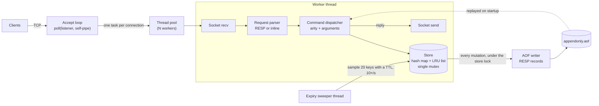

# MiniRedis

[](https://github.com/maitreya0106/miniredis/actions/workflows/ci.yml)

An in-memory key-value server in C++17, inspired by Redis. It speaks enough of the Redis protocol (RESP) for the official `redis-cli` and `redis-benchmark` to work against it. It has TTLs, LRU eviction and append-only-file persistence that survives `kill -9`.

It uses only the standard library and POSIX: no Boost, no libuv, no epoll/kqueue.

## Features

- **TCP server** on a fixed-size thread pool, one client per worker
- **Commands:** `PING`, `SET` (with `EX`, `PX`, `EXAT`, `PXAT`), `GET`, `DEL`, `EXISTS`, `EXPIRE`, `PEXPIREAT`, `TTL`, plus `CONFIG GET` (a stub for `redis-benchmark`)
- **Protocols:** RESP, as used by `redis-cli` and client libraries, and inline commands for `nc`/`telnet`. The protocol is detected per request.
- **Expiry** the Redis way: a lazy check on every access, plus a background sweep that samples keys with a TTL
- **LRU eviction** with a key limit, built on a hand-written intrusive doubly linked list
- **Append-only file** with `always` or `everysec` fsync. It's replayed on startup, and a torn final record from a crash is repaired.
- **Tests:** unit, integration and crash tests, run under ASan/UBSan and TSan in CI on Linux and macOS

## Quick start

```sh
cmake -S . -B build -DCMAKE_BUILD_TYPE=Release
cmake --build build
./build/miniredis --port 6380 --aof appendonly.aof
```

```console
$ redis-cli -p 6380 SET greeting "hello world" EX 60
OK
$ redis-cli -p 6380 GET greeting
"hello world"
$ redis-cli -p 6380 TTL greeting
(integer) 60
$ printf 'PING\r\n' | nc localhost 6380
+PONG
```

### Docker

```sh
docker build -t miniredis .     # also runs the test suite on Linux
docker run -p 6380:6380 miniredis
docker run -p 6380:6380 -v "$PWD/data:/data" miniredis --bind 0.0.0.0 --aof /data/appendonly.aof
```

### Options

| Flag | Default | Meaning |
|---|---|---|
| `--bind <ipv4>` | `127.0.0.1` | Address to listen on |
| `--port <n>` | `6380` | TCP port (`0` picks a free one) |
| `--threads <n>` | `16` | Worker threads, which is also the maximum number of concurrent clients |
| `--maxkeys <n>` | `0` | Evict least recently used keys beyond `n` (`0` = never) |
| `--aof <path>` | none | Log writes to this file and replay it on startup |
| `--fsync <policy>` | `everysec` | `always` (fsync before replying) or `everysec` |

## Architecture



A request goes through these steps:

1. The accept loop hands a new connection to the thread pool. A worker owns that client until it disconnects.
2. The worker reads into a buffer. The **request parser** extracts every complete request: a RESP array if it starts with `*`, an inline line otherwise. Partial requests wait for more bytes.
3. The **dispatcher** checks the command name and arity, parses options, and calls the store.
4. The **store** holds one mutex for the whole operation. Expired keys are deleted on access. A new key at capacity evicts the LRU tail.
5. Before applying a mutation, the store hands it to the **write log** (the AOF writer) while still holding the lock, so the file order always matches the order writes hit memory. Deadlines are logged as absolute times, and expirations and evictions as `DEL`s, so replay is deterministic.
6. Replies for all pipelined requests in the buffer go back in one `send()`.

| Directory | Contents |
|---|---|
| `src/server` | Thread pool, accept loop, connection handling, command dispatcher, CLI flags |
| `src/protocol` | Inline and RESP parsers, reply encoding |
| `src/store` | Store, intrusive LRU list, expiry sweeper, write-log interface |
| `src/persistence` | AOF writer (fsync policies) and loader (replay, torn-tail repair) |
| `tests` | GoogleTest suites, including the `kill -9` crash test |
| `bench` | Benchmark script against real Redis |
| `docs/DECISIONS.md` | Each design choice, its alternatives and its trade-offs |

## Durability

`always` fsyncs every write before replying, so nothing acknowledged is ever lost, but every client waits on the disk. `everysec` fsyncs once a second from a background thread, so a power failure can lose up to about a second of writes. A *process* crash loses nothing under either policy, because `write()` has already handed the data to the kernel.

The crash test proves the second claim. It starts the real binary, streams `SET`s from a client, `SIGKILL`s the server mid-stream, restarts it from the same AOF, and checks that every write the client saw acknowledged is still there, under both policies. A separate test checks that a half-written final record is truncated and the server still starts. See [docs/DECISIONS.md](docs/DECISIONS.md) for macOS `F_FULLFSYNC`, directory fsync and fail-stop on write errors.

## Benchmarks

`redis-benchmark -t set,get -n 200000 -r 100000`, with Redis 8.10.3 and MiniRedis (`--threads 128`, Release build) on the same Apple M4 Pro (12 cores, macOS). Neither server persists anything, except in the last row, where both use an AOF with `everysec`. Results vary by about ±15% between runs.

| Scenario | Clients | Redis SET/s | MiniRedis SET/s | Ratio | Redis GET/s | MiniRedis GET/s | Ratio |
|---|---:|---:|---:|---:|---:|---:|---:|
| In memory | 1 | 48508 | 51827 | 106% | 49285 | 51854 | 105% |
| In memory | 10 | 181818 | 128617 | 70% | 173461 | 127877 | 73% |
| In memory | 50 | 151860 | 121212 | 79% | 150943 | 124611 | 82% |
| In memory, pipeline 16 | 50 | 1438849 | 1005025 | 69% | 1739130 | 961538 | 55% |
| AOF, fsync everysec | 50 | 149925 | 108050 | 72% | 156986 | 126582 | 80% |

What the numbers say:

- **1 client:** the two are equal. A single client spends nearly all its time on the network round trip, so server design hardly matters.
- **10–50 clients:** MiniRedis plateaus at roughly 120–130k ops/s, about 70–80% of Redis. Every request takes the single store mutex, and each of the 50 worker threads does its own blocking `recv`/`send`, so the cost goes into context switches and lock hand-offs. Redis serves all 50 sockets from one thread with an event loop, with no locks at all.
- **Pipelining (16 commands per round trip):** both jump about 8×. Batching parsing and replies per `recv` amortises the syscalls, which shows the per-request syscall cost, not the data structure, is the bottleneck.
- **AOF `everysec`:** costs MiniRedis only about 10%. The `write()` lands in the page cache, and the fsync happens on a background thread.

Run them yourself:

```sh
cmake -S . -B build-release -DCMAKE_BUILD_TYPE=Release -DMINIREDIS_BUILD_TESTS=OFF
cmake --build build-release
bench/run_benchmarks.sh
```

## Testing

```sh
ctest --test-dir build --output-on-failure                           # all tests
./build/tests/miniredis_tests --gtest_filter='*Crash*'               # one suite
cmake -S . -B build-tsan -DMINIREDIS_SANITIZE=thread && cmake --build build-tsan && ctest --test-dir build-tsan
cmake -S . -B build-asan -DMINIREDIS_SANITIZE=address && cmake --build build-asan && ctest --test-dir build-asan
```

CI runs all of this on Ubuntu and macOS. It also runs `clang-format` and `clang-tidy` (version-pinned) and builds and smoke-tests the Docker image.

## Limitations and future work

These are deliberately out of scope:

- **Event loop (epoll/kqueue):** each client ties up a worker thread, so concurrency is capped at `--threads`, and idle clients cost a thread. An event loop would serve thousands of connections from a few threads.
- **Finer-grained locking:** a single store mutex serializes all commands. Sharded maps would scale writes across cores, at the cost of a global LRU order and a single AOF order.
- **AOF rewriting** (`BGREWRITEAOF`): the log grows forever, and startup time grows with it.
- **RDB snapshots, replication, clustering, pub/sub, Lua, and data types other than strings.**
- **A `maxclients` limit:** connections beyond the pool size queue silently instead of being rejected.
